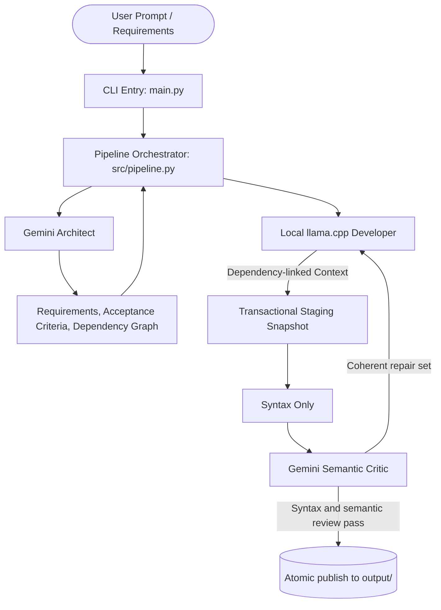

# PromptStudio Terminal Chat

PromptStudio is the primary interactive interface. It calls the Python pipeline
directly, so no web server or Node.js installation is needed for terminal use.
The existing `main.py` argument interface is unchanged.

## Install and launch

From `backend/`, with a virtual environment activated:

```bash
pip install -e .
promptstudio --mock
# Or, without installing the console command:
python promptstudio.py --mock
# Equivalent module entry point:
python -m src.studio --mock
```

For the script/module alternatives, install `pip install -r requirements.txt`
first. For live generation, copy `.env.example` to `.env`, set `GEMINI_API_KEY`,
start `llama-server`, then launch `promptstudio` without `--mock`.
The backend `.env` is resolved independently of your launch directory; environment
variables take precedence. Model and llama.cpp connection flags follow the
one-shot CLI names: `--model`, `--llama-model`, `--llama-url`,
`--llama-timeout`, and `--max-repair-attempts`.

Architect plans and final file summaries use the detailed original CLI tables,
including dependencies, responsibilities, line counts, generation times, and file
summaries. During generation, output stays brief: stage updates and a live file
count. Use `promptstudio --debug` (or `promptstudio --mock --debug`) to show
per-file progress and detailed agent diagnostics.

## Chat and follow-ups

Enter a project request, review the proposed technology choices and file changes,
and type `y` at `Build this plan? [y/N]`. A follow-up uses the current approved
source and conversation requirements. Changed files and dependent files are
regenerated in an isolated workspace. The full candidate is checked before it
replaces the published project. Local edits are detected before planning and
checked again before publication. Unmanaged assets and installed dependencies
are retained during updates; explicit planned removals affect managed files.

- `/help`: list commands.
- `/new`: save the current session and start an independent conversation.
- `/status`, `/files`, `/show <path>`: inspect the current project.
- `/retry`: retry a failed, declined, or interrupted request.
- `/exit` or Ctrl+D: save and exit. Ctrl+C cancels a running operation.

Resume with `promptstudio --resume <session-id>` from the original launch
directory. Sessions live in `.promptstudio/sessions/`, contain conversation and
project source, and are ignored by Git. They do not store model credentials.
Treat saved conversations as local project data. Only PromptStudio-created
projects are supported; arbitrary repository import is not part of this version.
Project paths are absolute in saved sessions. Custom model/connection flags can
be supplied again when resuming; the saved live/mock mode is retained.

Mock mode is a deterministic Quicknote demo. It creates the existing sample
project, then appends follow-up requests to README.md to demonstrate update and
resume behavior. It does not implement arbitrary requested features.

QA remains the existing syntax and semantic review workflow, not execution of
application tests or installation of generated dependencies. Progress is reported
per stage and completed file, rather than streamed model tokens.

## Contributor verification

```bash
python -m pytest tests/ -q
```

Pipeline callers can use `execute(prompt, baseline=..., files=...,
before_publish=...)` for a structured `PipelineResult`, optional `on_event`
notifications, and `confirm_plan` callbacks. `run(prompt) -> bool` and the original
CLI retain their existing presentation and argument behavior.

---

## Pipeline Architecture Reference

An automated CLI-first system where specialized AI roles design, implement, validate, review, and repair software applications based on user prompts.

Gemini handles architecture and semantic review, a local llama.cpp model handles code generation, deterministic tools perform validation, and LangGraph shares state and controls the bounded repair loop.

---

## 🏛 Architecture & Agent Workflow



---

## 📂 Modular Project Structure & Explanation Guide

The codebase is split into focused, single-responsibility files to make explaining the system easy and structured:

```
.
├── main.py                     # Entry point (CLI argument parsing and pipeline launcher)
├── agents.py                   # Compatibility bridge exporting agent runners
├── requirements.txt            # Dependencies (LangGraph, google-genai, Pydantic, Rich)
├── .env.example                # Environment variable configuration template
├── context.md                  # Project context and milestone tracker
└── src/
    ├── config.py               # Central environment and Gemini API client management
    ├── schemas.py              # Pydantic data contracts (inter-agent communication)
    ├── pipeline.py             # LangGraph workflow and conditional repair routing
    ├── state.py                # Shared ProjectState definition
    ├── agents/
    │   ├── architect.py        # Role 1: System decomposition & file planning
    │   ├── developer.py        # Role 2: Local context-aware code generation
    │   ├── qa.py               # Role 3: Fast syntax-only validation
    │   └── critic.py           # Role 4: Gemini semantic review
    ├── utils/
    │   ├── file_manager.py     # Safe file writing and line counting
    │   └── ui.py               # Rich terminal tables, banners, and status reporting
    └── mocks/
        └── demo_data.py        # Offline simulation responses for reliable demos
```

### How to Explain Each Component:

| File | Core Concept | Presentation Talking Point |
| :--- | :--- | :--- |
| **`src/schemas.py`** | **Data Contracts** | Preserves the original request and defines assumptions, acceptance criteria, dependency inventory, file contracts, and QA evidence. |
| **`src/agents/architect.py`** | **Decomposition Agent** | Produces a proportional behavioral contract and ordered internal dependency graph; tests are optional in demo mode. |
| **`src/agents/developer.py`** | **Context-Aware Coding** | Uses the verbatim request plus dependency-linked implementation, dependent, configuration, and test context. |
| **`src/pipeline.py`** | **Workflow Orchestration** | Isolates each run, commits repairs transactionally, detects stalled repairs, and publishes only approved manifest files. |
| **`src/config.py`** | **Configuration Layer** | Centralizes API key handling, environment variables, and Gemini client instantiation. |
| **`src/mocks/demo_data.py`** | **Offline Demonstration** | Guarantees an immediate, foolproof live demo during presentations even without Wi-Fi or API quota. |

The Architect selects the language, framework, package manager, native manifest, and install/run/test commands. The Developer follows those choices and applies ecosystem-specific APIs and conventions; it is not restricted to Python projects.

The pipeline also infers a proportional complexity profile. Prompts containing words such as `simple`, `basic`, or `minimal` use a lightweight profile: React projects prefer JavaScript unless TypeScript is explicitly requested, automated tests are omitted unless requested, and unnecessary hooks, service layers, and speculative infrastructure are rejected. The Critic checks only semantic correctness of requested behavior and returns explanations plus targeted recommendations for existing files; it cannot request or generate new files.

For Vite/React projects, lightweight semantic startup guards verify that `index.html` loads the planned module entry, the HTML mount element matches the React entry, React actually renders a root, and default component imports agree with exports. These checks catch common “successful build but blank page” failures without installing packages or running a browser.

The repair loop allows five iterations by default. Feedback is cumulative per file, unchanged repair candidates are rejected before they consume an outer iteration, and later attempts escalate from symptom patches to a coherent internal state-machine rewrite. Only files explicitly identified by the Critic are regenerated, so a component logic repair does not disturb an already-correct entry point.

---

## 🚀 Quickstart

### 1. Setup Virtual Environment & Dependencies

```bash
# Create and activate virtual environment
python3 -m venv .venv
source .venv/bin/activate

# Install dependencies
pip install -r requirements.txt
```

### 2. Configure Gemini API Key (Optional for Mock Demo)

Copy `.env.example` to `.env` and add your Google Gemini API key:

```bash
cp .env.example .env
```

Edit `.env`:
```env
GEMINI_API_KEY=your_actual_gemini_api_key_here
GEMINI_MODEL=gemini-3.8-flash
LLAMA_CPP_BASE_URL=http://localhost:8080
LLAMA_CPP_MODEL=local-model
LLAMA_CPP_TIMEOUT=120
```

*(If no API key is detected, the orchestrator automatically runs in demo/simulation mode so you can test the pipeline immediately).*

---

## 💻 Running the Demo

### Option A: Instant Mock / Simulation Demo (No API Key Required)
Run the full multi-agent pipeline with a built-in realistic mock scenario:
```bash
python main.py --mock
```
Or specify a custom prompt:
```bash
python main.py --mock -p "Build a markdown note-taking CLI tool"
```

### Option B: Live Gemini API Generation
Generate a brand-new application using Gemini for reasoning and llama.cpp for code:
```bash
python main.py -p "Create a CLI Pomodoro timer with sound notification support and task tracking"
```

Start your model with `llama-server` before running the live workflow. For example:

```bash
llama-server -m /path/to/model.gguf --host 127.0.0.1 --port 8080 -c 16384
```

The demo QA gate is intentionally fast: it parses strict JSON and Python/JavaScript where local parsers are available, and performs a lightweight structural check for JSX and TypeScript. It does not compare dependencies, install packages, build the app, or run generated tests. `--run-tests` and `--install-dependencies` are reserved for a future strict-validation mode and currently do not expand QA scope.

An approved result therefore means “syntax and semantic review passed,” not production verification. After generation, install dependencies and launch the app with the commands printed in the summary for a final manual demo check.

The final destination is never mixed with an earlier run. If `output/<project-name>` already exists, choose another output directory or explicitly pass `--overwrite`. Overwrite occurs only after the replacement snapshot has passed every approval gate.

### Option C: Interactive Review Mode
Review the Architect's planned file structure and confirm before the Developer Agent starts writing code:
```bash
python main.py --mock -i
```

---

## 🧪 Testing the Generated Code

After running the pipeline, inspect and execute the generated project in `output/<project-name>`:
```bash
# For example, with the default quicknote demo:
cd output/quicknote-cli
python3 -m quicknote.cli --help
python3 -m quicknote.cli add "Demo Note" "Multi-agent systems work!" -t demo ai
python3 -m quicknote.cli list
```
