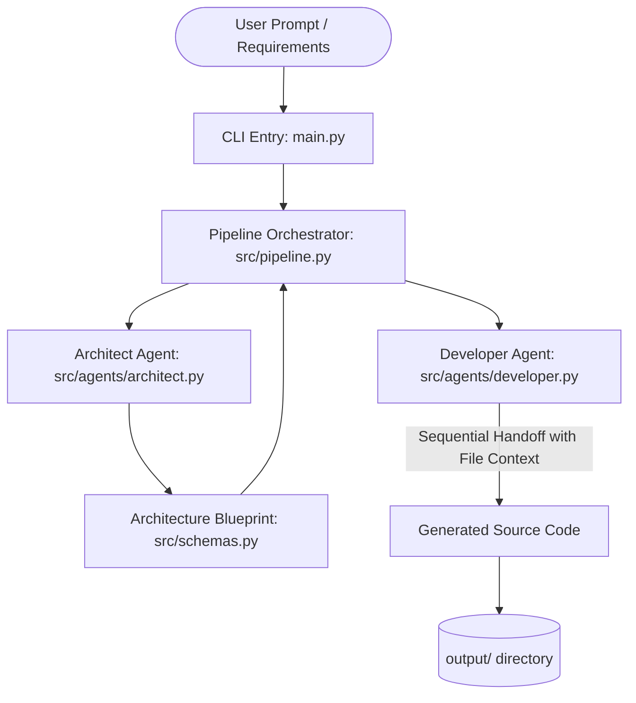

# Collaborative Multi-Agent Software Development Pipeline

An automated multi-agent system where specialized AI roles (**Architect** and **Developer**) collaborate sequentially to design, plan, and implement complete software applications based on user prompts.

Powered by Google's **Gemini 2.5 Flash** via the official `google-genai` SDK with Pydantic structured outputs.

---

## 🏛 Architecture & Agent Workflow



---

## 📂 Modular Project Structure & Explanation Guide

The codebase is split into focused, single-responsibility files to make explaining the system easy and structured:

```
.
├── main.py                     # Entry point (CLI argument parsing and pipeline launcher)
├── agents.py                   # Compatibility bridge exporting agent runners
├── requirements.txt            # Dependencies (google-genai, pydantic, rich, python-dotenv)
├── .env.example                # Environment variable configuration template
├── context.md                  # Project context and milestone tracker
└── src/
    ├── config.py               # Central environment and Gemini API client management
    ├── schemas.py              # Pydantic data contracts (inter-agent communication)
    ├── pipeline.py             # Sequential multi-agent workflow orchestration
    ├── agents/
    │   ├── architect.py        # Role 1: System decomposition & file planning
    │   └── developer.py        # Role 2: Context-aware code generation
    ├── utils/
    │   ├── file_manager.py     # Safe file writing and line counting
    │   └── ui.py               # Rich terminal tables, banners, and status reporting
    └── mocks/
        └── demo_data.py        # Offline simulation responses for reliable demos
```

### How to Explain Each Component:

| File | Core Concept | Presentation Talking Point |
| :--- | :--- | :--- |
| **`src/schemas.py`** | **Data Contracts** | Demonstrates how agents communicate using strictly typed Pydantic models (`ArchitectureBlueprint`, `FileSpec`, `GeneratedFile`) to eliminate JSON parsing errors. |
| **`src/agents/architect.py`** | **Decomposition Agent** | Translates user requirements into a modular file plan, assigning distinct responsibilities and ordering dependencies logically. |
| **`src/agents/developer.py`** | **Context-Aware Coding** | Writes functional code file-by-file. Injects snippets of previously written files into prompt context so imports and interfaces align cleanly. |
| **`src/pipeline.py`** | **Workflow Orchestration** | Manages state transitions, handoffs, optional human-in-the-loop review, and error handling. |
| **`src/config.py`** | **Configuration Layer** | Centralizes API key handling, environment variables, and Gemini client instantiation. |
| **`src/mocks/demo_data.py`** | **Offline Demonstration** | Guarantees an immediate, foolproof live demo during presentations even without Wi-Fi or API quota. |

---

## 🚀 Quickstart

### 1. Setup Virtual Environment & Dependencies

```bash
# Create and activate virtual environment
python3 -m venv .venv
source .venv/bin/activate

# Install dependencies
pip install -r requirements.txt
```

### 2. Configure Gemini API Key (Optional for Mock Demo)

Copy `.env.example` to `.env` and add your Google Gemini API key:

```bash
cp .env.example .env
```

Edit `.env`:
```env
GEMINI_API_KEY=your_actual_gemini_api_key_here
GEMINI_MODEL=gemini-2.5-flash
```

*(If no API key is detected, the orchestrator automatically runs in demo/simulation mode so you can test the pipeline immediately).*

---

## 💻 Running the Demo

### Option A: Instant Mock / Simulation Demo (No API Key Required)
Run the full multi-agent pipeline with a built-in realistic mock scenario:
```bash
python main.py --mock
```
Or specify a custom prompt:
```bash
python main.py --mock -p "Build a markdown note-taking CLI tool"
```

### Option B: Live Gemini API Generation
Generate a brand-new application using `gemini-2.5-flash`:
```bash
python main.py -p "Create a CLI Pomodoro timer with sound notification support and task tracking"
```

### Option C: Interactive Review Mode
Review the Architect's planned file structure and confirm before the Developer Agent starts writing code:
```bash
python main.py --mock -i
```

---

## 🧪 Testing the Generated Code

After running the pipeline, inspect and execute the generated project in `output/<project-name>`:
```bash
# For example, with the default quicknote demo:
cd output/quicknote-cli
python3 -m quicknote.cli --help
python3 -m quicknote.cli add "Demo Note" "Multi-agent systems work!" -t demo ai
python3 -m quicknote.cli list
```
